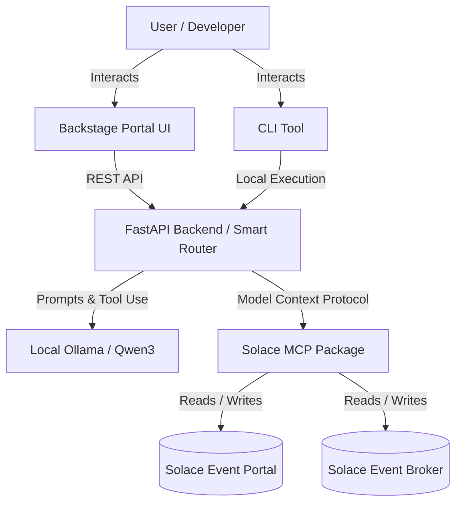

# EventFlow AI

EventFlow AI is an intelligent assistant for the Solace Event Portal and Event Broker. It allows you to explore, query, and manage your Event-Driven Architecture (EDA) using natural language.

Built on the Model Context Protocol (MCP) and powered by local LLMs (Ollama), EventFlow AI ensures your data stays completely private. It features a dedicated Backstage React frontend and a highly robust Python Smart Router that safely handles complex Solace MCP Server interactions locally.

## Architecture



## Prerequisites

1. **Python 3.10+**
2. **[uv](https://github.com/astral-sh/uv)**: An extremely fast Python package and project manager.
3. **[Ollama](https://ollama.com/)**: Must be installed and running locally.
4. **Qwen3 Model**: Pull the required model via Ollama:
   ```bash
   ollama run qwen3:8b
   ```
5. **Node.js & Yarn**: Required to run the Backstage frontend portal.

## Setup

1. **Clone the repository** and navigate to the project root.
2. **Create a `.env` file** in the root directory based on the following template (or simply copy `.env.example` to `.env` and fill it in):
   ```env
   # Design-Time (Event Portal) Credentials
   SOLACE_API_TOKEN=your_solace_token_here
   SOLACE_API_BASE_URL=https://api.solace.cloud
   
   # Runtime (Event Broker) Credentials
   SOLACE_SEMPV2_BASE_URL=https://your-broker-url:943
   SOLACE_SEMPV2_VPN=default
   SOLACE_SEMPV2_USERNAME=admin
   SOLACE_SEMPV2_PASSWORD=password
   
   # AI Model Configuration
   LLM_MODEL=qwen3:8b
   LLM_BASE_URL=http://localhost:11434
   ```

## Usage

You can interact with EventFlow AI through the Command-Line Interface (CLI) or the graphical Web User Interface (UI).

### Option A: Command-Line Interface (CLI)
Start the interactive CLI application using `uv`:

```bash
uv run python LLM/cli.py
```

### Option B: Backstage Developer Portal (UI)
Start the FastAPI backend server to provide the API for the frontend UI:

```bash
uv run python LLM/main.py
```
*(Alternatively, you can run `uvicorn LLM.main:app --host 0.0.0.0 --port 8000`)*

Next, start the Backstage React frontend portal:

```bash
cd Backstage/eventflow-ai-portal
yarn start
```

Then open **http://localhost:3000** in your web browser to access the Backstage EventFlow AI plugin.

The application will prompt you to select a persona (Admin or End User). Once connected, you can type your questions directly into the prompt. The Admin persona features a **Human-in-the-Loop** pause, asking for your explicit approval before executing any Create, Update, Delete, or Duplicate operations!

### Available Commands in CLI
Inside the CLI chat, you can use the following commands:
- `/tools` - View the active tools provided to the LLM.
- `/persona` - Switch between Admin and End User mode.
- `/clear` - Clear the terminal and conversation history.
- `/help` - View help information.
- `/exit` - Exit the application.
